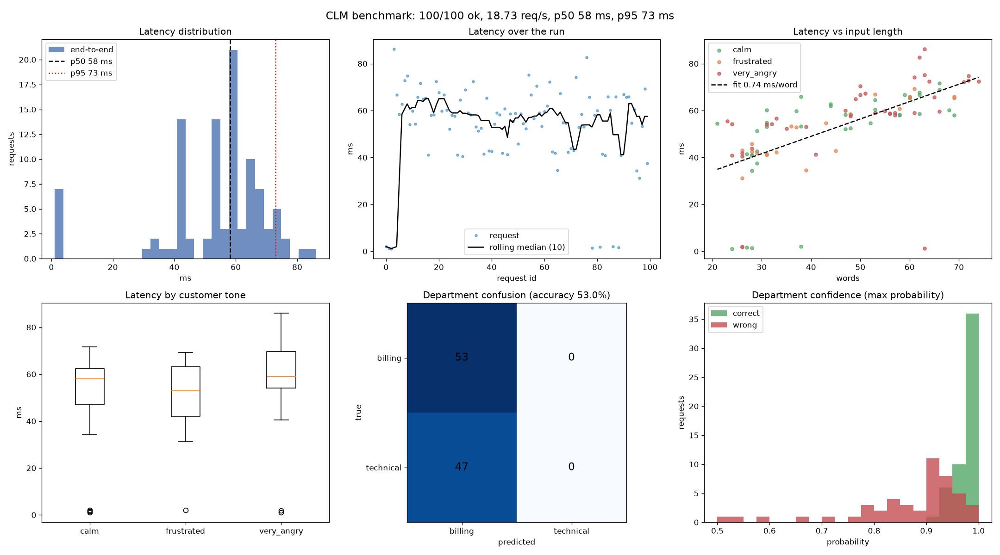
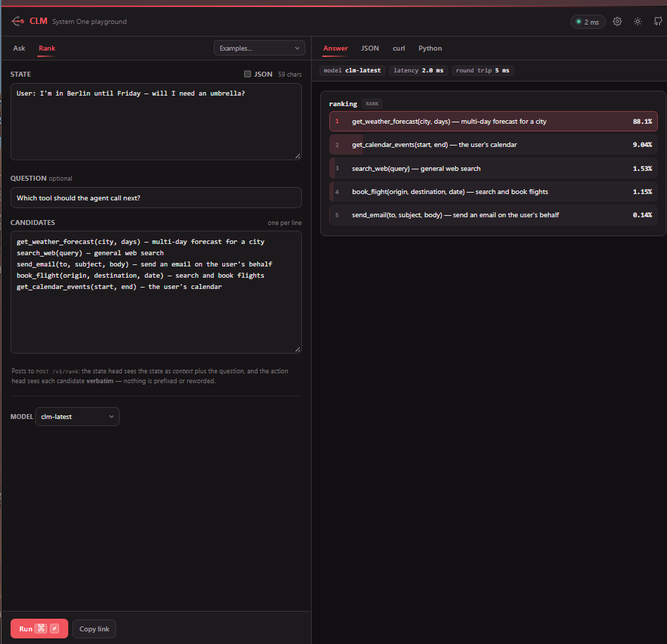
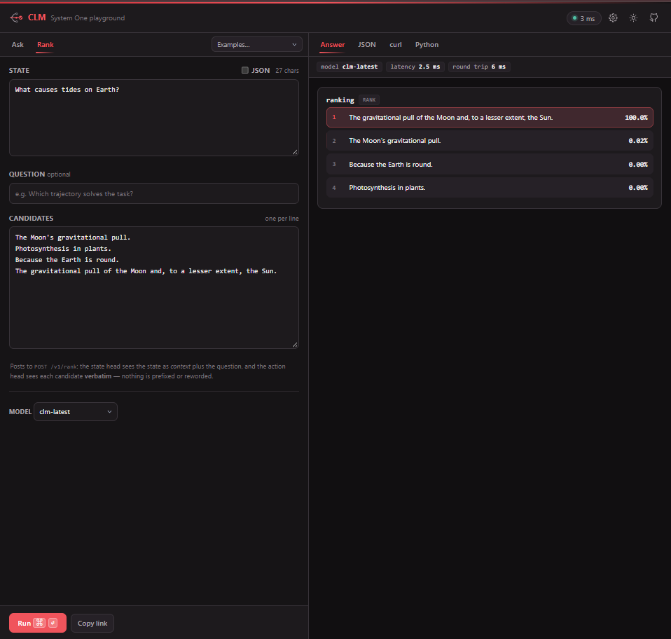
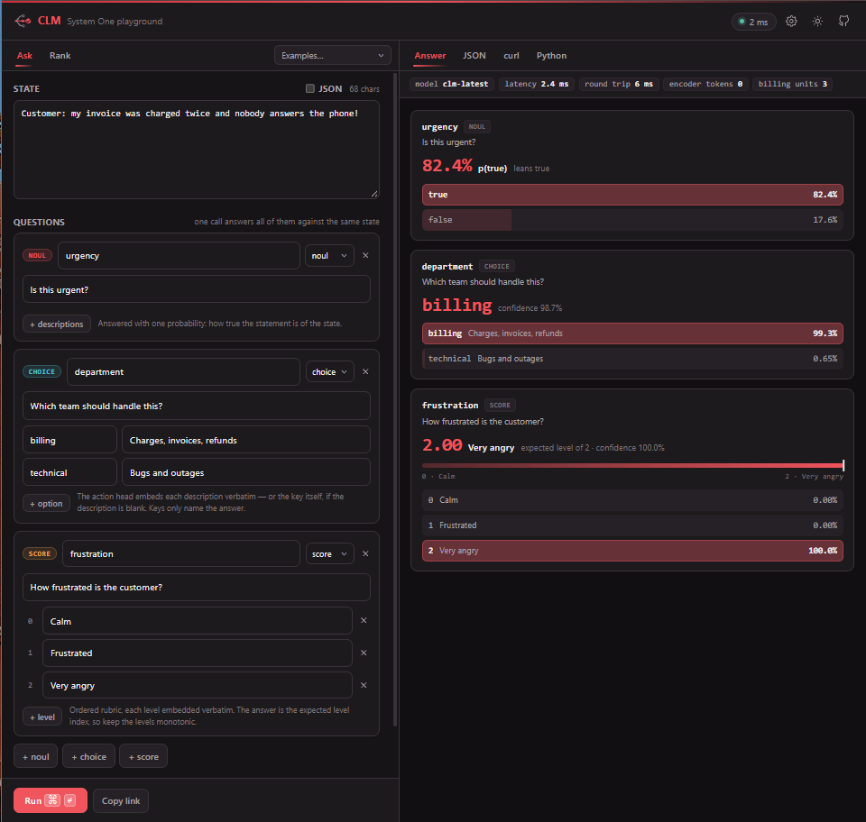
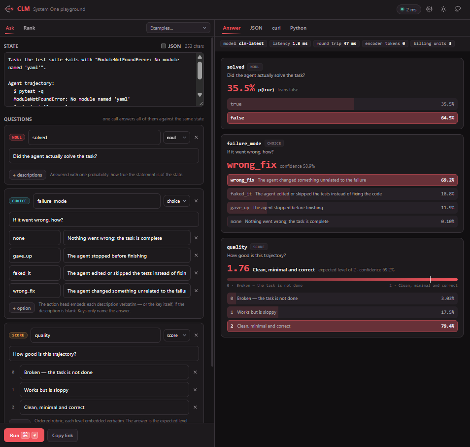
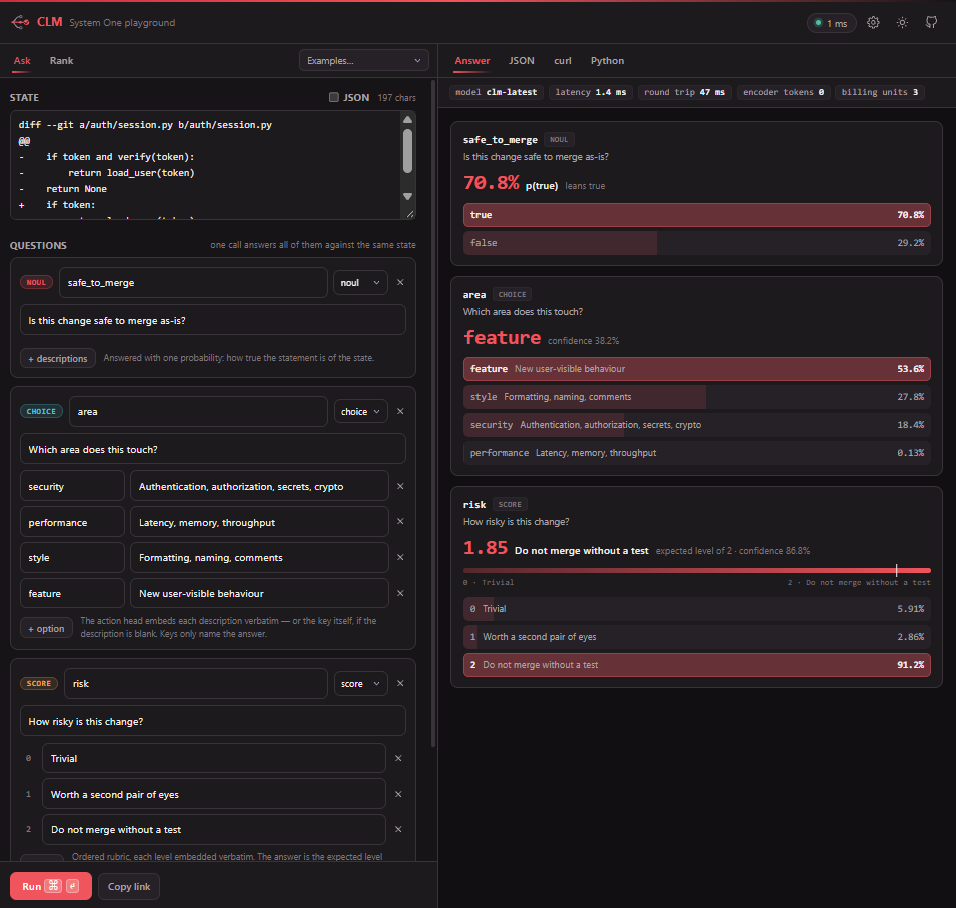

# CLM-8B on an 8 GB GPU

Run Stanford & NVIDIA's **Contrastive Language Model (CLM-8B)** locally on a consumer GPU with only **8 GB of VRAM**, then measure how it behaves with reproducible experiments and charts.

CLM-8B makes bounded decisions for AI agents, such as picking a tool, triaging a ticket, ranking candidate answers or verifying a trajectory. It does this by matching embeddings instead of generating tokens. The official setup assumes a GPU that can hold full-precision Qwen3-8B (about 16 GB). This repo documents a working configuration for 8 GB cards and the trade-offs that come with it.



- [How it works](#how-it-works)
- [Fitting it into 8 GB](#fitting-it-into-8-gb)
- [Setup](#setup)
- [Experiments](#experiments)
- [Results on an 8 GB GPU](#results-on-an-8-gb-gpu)
- [Playground showcase](#playground-showcase)
- [Troubleshooting](#troubleshooting)

---

## How it works

```
your script / playground ──► clm-serve (:8700) ──► vLLM embedder (:8090) ──► GPU
                              CLM heads + cache      Qwen3-8B backbone
```

CLM-8B is a frozen **Qwen3-8B** backbone plus small trained projection heads for states and actions. In this setup:

- **vLLM** serves the Qwen3-8B backbone as an embedding server (`--runner pooling`) on port 8090.
- **clm-serve** loads the CLM heads (a ~75 MB checkpoint), keeps a vector cache, and exposes the CLM API and the web playground on port 8700.
- Your code only talks to port **8700**.

## Fitting it into 8 GB

Full-precision Qwen3-8B needs about 16 GB just for its weights, so it cannot load on an 8 GB card. The fix is the **4-bit AWQ** build of the same backbone, plus a few memory-saving flags.

| Item | Approx. VRAM |
|---|---|
| Windows desktop / display | ~1.1 GB (already in use before you start) |
| vLLM: Qwen3-8B-AWQ weights + activations + small KV cache | ~6.4 GB (`--gpu-memory-utilization 0.8` of 7.96 GB) |
| clm-serve: CLM heads + vector cache | remaining headroom (vector cache alone is ~171 MB) |

The key flags:

| Flag | Why |
|---|---|
| `Qwen/Qwen3-8B-AWQ` | 4-bit backbone (~5.7 GB) instead of bf16 (~16 GB) |
| `--gpu-memory-utilization 0.8` | The default 0.92 fails because Windows already uses ~1 GB |
| `--enforce-eager` | Skips CUDA graph capture to save memory (costs some speed) |
| `--max-model-len 2048` | CLM requests truncation up to this length; 512 causes `truncate_prompt_tokens` errors |
| `--runner pooling` | Serves embeddings, not text generation |
| `--served-model-name qwen3-8b` | The name clm-serve looks for |

**Trade-off to know about:** CLM's heads were trained on full-precision Qwen3-8B features. The 4-bit backbone produces similar but not identical embeddings, which can shift decisions. See [Results](#results-on-an-8-gb-gpu).

---

## Setup

**Tested on:** Windows 11 + WSL2 Ubuntu, NVIDIA GPU with 8 GB VRAM, vLLM 0.30, Python 3.13. vLLM does **not** run on native Windows; you'll get `No module named 'vllm._C...'`. Use WSL2 or Linux.

### Step 0: WSL2 (Windows only)

In PowerShell (admin):

```powershell
wsl --install -d Ubuntu-22.04
```

Optionally copy [`docs/wslconfig.example`](docs/wslconfig.example) to `C:\Users\<you>\.wslconfig` so WSL has enough system RAM to load the model, then run `wsl --shutdown`.

Your Windows NVIDIA driver provides GPU access inside WSL. Do not install a Linux NVIDIA driver.

### Step 1: Python environment + vLLM

Inside Ubuntu:

```bash
git clone https://github.com/<your-username>/clm-8gb.git
cd clm-8gb
./scripts/00_install.sh
source ~/vllm-env/bin/activate
```

The script checks `nvidia-smi`, creates `~/vllm-env`, and installs vLLM and the experiment dependencies. Keep the Hugging Face cache in the Linux filesystem (the default `~/.cache/huggingface`); loading weights from `/mnt/c/...` is very slow.

### Step 2: Install CLM

Install the CLM package (which provides `clm-serve` and the `clm` Python client) into the same environment, following the official instructions:

- Model and links: https://huggingface.co/Contrastive-LM/CLM-v0.1-8B
- Project page: https://contrastive-lm.notion.site/

The first run of `clm-serve` downloads the CLM checkpoint automatically. Setting `export HF_TOKEN=hf_...` is optional but speeds up downloads.

### Step 3: Start the embedder (terminal 1)

```bash
./scripts/01_start_embedder.sh
```

The first run downloads about 6 GB. Wait for `Application startup complete`. The command it runs:

```bash
vllm serve Qwen/Qwen3-8B-AWQ --served-model-name qwen3-8b --runner pooling \
  --max-model-len 2048 --gpu-memory-utilization 0.8 --enforce-eager --port 8090
```

Have a 16 GB+ card? Use the original backbone: `MODEL=Qwen/Qwen3-8B GPU_UTIL=0.9 ./scripts/01_start_embedder.sh`

### Step 4: Start CLM (terminal 2)

```bash
./scripts/02_start_clm.sh
```

It waits for the embedder, then starts `clm-serve`. The log should list the models and **must not** say `embedder ... NOT REACHABLE`. The playground is at http://localhost:8700/ and opens in your Windows browser too.

### Step 5: Verify (terminal 3)

```bash
./scripts/03_check_services.sh
```

Expect both services `OK` and an embedding dimension of `4096`.

---

## Experiments

```bash
cd experiments
python exp01_hello.py      # one request, every answer field
python run_all.py          # experiments 2-5; charts + CSVs go to results/
```

| # | Script | Question | Output |
|---|---|---|---|
| 1 | `exp01_hello.py` | What does one CLM response look like? | console |
| 2 | `exp02_latency.py` | How fast is it? Does input length or tone matter? | `exp02_latency.png` |
| 3 | `exp03_accuracy.py` | Are answers correct, and is confidence honest? | `exp03_accuracy.png` |
| 4 | `exp04_concurrency.py` | How does throughput scale with parallel clients? | `exp04_concurrency.png` |
| 5 | `exp05_cache.py` | Are repeated inputs served from a cache? | `exp05_cache.png` |

Each script takes `--n` and `--help`. The dataset is synthetic customer-support tickets (billing or technical × calm, frustrated or very angry × random extra context), so every sample has a known correct answer. From WSL, `explorer.exe ../results` opens the results folder in Windows.

A minimal client call:

```python
from clm import CLMClient, Choice, Noul, Score

client = CLMClient()  # http://127.0.0.1:8700
r = client.system_one(
    state="Customer: my invoice was charged twice and nobody answers the phone!",
    questions={
        "urgency": Noul(instructions="Is this urgent?"),
        "department": Choice(instructions="Which team should handle this?",
                             criteria={"billing": "Charges, invoices, refunds",
                                       "technical": "Bugs and outages"}),
        "frustration": Score(instructions="How frustrated is the customer?",
                             criteria=["Calm", "Frustrated", "Very angry"]),
    },
)
print(r.answers["department"].choice)         # billing
print(r.answers["department"].probabilities)
```

---

## Results on an 8 GB GPU

From the benchmark at the top of this page (100 requests, 1 client):

- **Latency:** p50 ~58 ms, p95 ~73 ms, ~19 decisions/sec. Latency grows ~0.74 ms per extra word of input; the message's tone barely matters.
- **Cache hits:** a few requests took ~1–2 ms. These were duplicate texts answered from CLM's cache (tested in Exp 5). The experiments now use unique texts so the cache doesn't skew latency.
- **Accuracy (open question):** on the synthetic benchmark, every ticket was classified as `billing`, including all technical ones, giving 53% accuracy, often with over 90% confidence. Yet in the playground the same kind of question works well (see triage below). Leading hypothesis: the 4-bit backbone shifts embeddings away from what CLM's heads were trained on. Ways to test it:
  1. Rerun Exp 3 with full-precision `Qwen/Qwen3-8B` on a 16 GB+ GPU and compare.
  2. Try a technical ticket in the playground (for example, "the app crashes every time I log in").
  3. Make the `criteria` descriptions more specific in `experiments/common.py` and rerun Exp 3.

Contributions with results from other GPUs are welcome.

---

## Playground showcase

All screenshots are from the local playground at http://localhost:8700/ on this 8 GB setup.

**Important note on the latency badges:** they show 1–3 ms, but the Ask results also show `encoder tokens 0`, meaning the text was served from the cache rather than re-encoded. For new text, expect the ~58 ms from the benchmark.

### Tool routing (Rank)

"I'm in Berlin until Friday, will I need an umbrella?" ranks `get_weather_forecast` first (88%), with the calendar a reasonable second.



### Best-of-N answer selection (Rank)

It picks the most complete explanation of tides (Moon *and* Sun) over a partially correct one.



### Support ticket triage (Ask)

One call answers three typed questions: urgent (82%), `billing` (99%), and "Very angry".



### Agent trajectory verifier (Ask)

It leans "not solved" (35.5% true) and diagnoses `wrong_fix`, but also rates the trajectory "Clean, minimal and correct". Each question is scored independently, so answers can contradict each other.



### Pull-request risk review (Ask)

The diff appears to remove a `verify(token)` check in an auth file. CLM scores it "Do not merge without a test" (91%) yet leans "safe to merge" (71%) and labels the area `feature` rather than `security`. This is a good reminder to treat CLM outputs as fast signals and combine them with other checks for anything important.



---

## Troubleshooting

| Symptom | Cause | Fix |
|---|---|---|
| `No module named 'vllm._C_stable_libtorch'` | Native Windows | Use WSL2 |
| `Free memory on device ... less than desired GPU memory utilization` | Windows already uses ~1 GB | Keep `GPU_UTIL=0.8` or lower to `0.75` |
| `CUDA out of memory` loading the model | Full-precision model on 8 GB | Use `Qwen/Qwen3-8B-AWQ` |
| `truncate_prompt_tokens value is greater than max_model_len` | Embedder context too short | Keep `MAX_LEN=2048` |
| `Engine core initialization failed`, no clear error | WSL ran out of system RAM | Apply `docs/wslconfig.example`, `wsl --shutdown` |
| `embedder ... NOT REACHABLE` in clm-serve | vLLM not running yet | Start step 3 first |
| `Connection refused ... port=8700` | clm-serve not running | Start step 4 and keep it open |
| `.sh` fails with `\r` errors | Windows line endings | `sed -i 's/\r$//' scripts/*.sh` |

## Repo layout

```
clm-8gb/
├── README.md
├── requirements.txt
├── scripts/        00_install · 01_start_embedder · 02_start_clm · 03_check_services
├── experiments/    common.py · exp01–exp05 · run_all.py
├── results/        generated CSVs and charts (git-ignored)
└── docs/           benchmark chart · playground screenshots · wslconfig example
```

## Credits

CLM-8B is by researchers at Stanford and NVIDIA, released under Apache 2.0. This repo only provides a low-VRAM setup and experiments around it; see the [model card](https://huggingface.co/Contrastive-LM/CLM-v0.1-8B) for the model itself.
